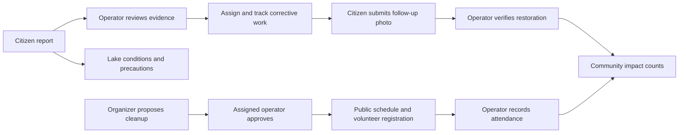

<p align="center">
  
</p>

# JalNetra

**Community lake protection and restoration for Bengaluru.**

JalNetra connects citizen shoreline reports to practical precautions, organized cleanups, and operator follow-up. It covers 21 mapped lakes. A citizen can submit a photo or concern, check recent observations, and join an approved cleanup. An assigned operator can review evidence, track corrective work, and verify a restoration from a citizen's follow-up photo.

[Live citizen homepage](https://jalnetra-wine.vercel.app/) · [Community Drives](https://jalnetra-wine.vercel.app/community.html) · [Citizen lake map and reporting](https://jalnetra-wine.vercel.app/pilot.html?role=citizen) · [Operator sign in](https://jalnetra-wine.vercel.app/pilot.html?role=operator) · [Public rehearsal](https://jalnetra-wine.vercel.app/?demo=1)

[Evaluation](#start-here-for-evaluation) · [Community workflow](#how-the-community-workflow-works) · [Architecture](#system-architecture) · [Verification](#verification) · [Local setup](#run-locally) · [Evidence limits](#interpreting-the-results)

## Start here for evaluation

| What to examine | How to see it |
| --- | --- |
| Community benefit | Open **Community Drives** to see the public cleanup schedule. Approved drives scheduled for today in Bengaluru also appear on the citizen homepage. The homepage hides that section when today's schedule is empty. |
| Prevention | Open **Citizen lake map and guest reporting**, select a lake, and read **Lake conditions** and its precautions. Lake follows and personal checklists are saved on the current device. Account-level subscriptions enable in-app concern alerts. |
| Report to complaint | Use the public rehearsal. It demonstrates a seeded foam report, evidence grouping, and a downloadable complaint draft without requiring an account. |
| Work after reporting | In the operator workspace, a verified pollution report can become assigned corrective work. After the operator records completion, a citizen can submit a fresh photo from the same sector. An operator reviews that photo before the restoration is counted as verified. |
| Measurable outcomes | **Community impact** shows completed cleanups, volunteers with operator-recorded attendance, active lake adoptions, and verified restorations. Counts come from stored records, so a lake can have zero activity. |

The [evaluation walkthrough](docs/BUILD_AND_DEMO.md) includes a three-minute presentation, an offline fallback, and a checklist for the organizer and operator workflows.

## How the community workflow works

1. **Observe and protect.** Citizens submit shoreline photos or concerns. Image analysis identifies visible cues such as foam, algae-like growth, and dumping. Recent observations inform precautions on the lake conditions page.
2. **Organize action.** Community groups sign in with a confirmed email and propose a drive. An assigned lake operator reviews it before publication. Citizens can register as volunteers. Groups can also submit a lake adoption plan for approval.
3. **Track the result.** Operators record cleanup attendance and track corrective work. Follow-up photos stay private to the authorized review workflow. Verified restorations and recorded cleanup participation feed the lake's impact dashboard.

### From observations and drives to recorded outcomes



## System architecture

| Layer | Implementation |
| --- | --- |
| Browser | HTML, CSS, and JavaScript for citizen, organizer, and operator workflows |
| Server | Node.js 24 with a Vercel entry point for the shared pilot and hosted rehearsal |
| Shared data | Supabase Auth, Postgres, and private photo storage |
| Rehearsal | SQLite, with isolated browser sessions on Vercel and an in-memory offline mode |
| Image analysis | Server-side provider adapters with labelled examples for rehearsal |

See the [deployment and component guide](docs/ARCHITECTURE.md) and [shared pilot access rules](docs/SUPABASE_PILOT.md).

## Verification

| Check | What it establishes |
| --- | --- |
| [Node test suite](test/) and [GitHub Actions](https://github.com/BagaaBhai28/JalNetra/actions/workflows/tests.yml) | Report intake, evidence grouping, rehearsal, API access, and regression checks run in CI. |
| [Database checks](supabase/tests/) | Lake roles, drive approval, Bengaluru date boundaries, attendance counts, and restoration verification are exercised with rollback fixtures. |
| [Evaluator walkthrough](docs/BUILD_AND_DEMO.md) | The public rehearsal is available without credentials. The shared walkthrough requires a confirmed organizer email and an assigned operator account. |

Public production checks covered the page and schedule API. An organizer's email confirmation and a real drive from approval through attendance still need to be demonstrated together on production.

## Run locally

Use **Node.js 24** from the repository root. The offline rehearsal runs without extra packages or API credentials.

```bash
node src/server.js --rehearsal
```

Open `http://127.0.0.1:3000`. Click **Start rehearsal**, then submit **Foam from a second view** at **North Inlet**. Open the new **Priority hotspot** and download its complaint draft. Submit **Obscured view** to demonstrate **Needs review**. **Restart rehearsal** resets the example.

Run the automated suite separately.

```bash
node --test
```

The shared pilot and Community Drives use the deployed Supabase backend. The [pilot setup guide](docs/SUPABASE_PILOT.md) covers database migrations, role setup, email confirmation, and rollback-based database tests.

## Repository map

| Path | Purpose |
| --- | --- |
| [public/](public/) | Citizen reporting and maps, community drive and organizer pages, and operator workspace. |
| [src/](src/) | Report intake, image analysis, evidence grouping, hosted rehearsal, and shared pilot API. |
| [api/jalnetra.js](api/jalnetra.js) | Vercel entry point for the rehearsal and shared pilot. |
| [supabase/migrations/](supabase/migrations/) | Shared data model, lake access controls, and community workflows. |
| [test/](test/) and [supabase/tests/](supabase/tests/) | Node tests and rollback-based database checks. |

## Interpreting the results

- Photos support visual triage. Water quality, pollutant source, and safety require appropriate field verification and measurements. Optional pH and temperature entries are citizen-reported.
- The 48-hour hotspot window and escalation threshold are prototype rules used for evidence triage. The public rehearsal uses labelled example results.
- Complaint drafts are exported for human review and filing. The operator checks the intended recipient.
- Concern alerts appear in JalNetra's in-app inbox. Cleanup attendance and approved follow-up evidence are recorded outcomes, while impact counts do not establish ecological recovery.
