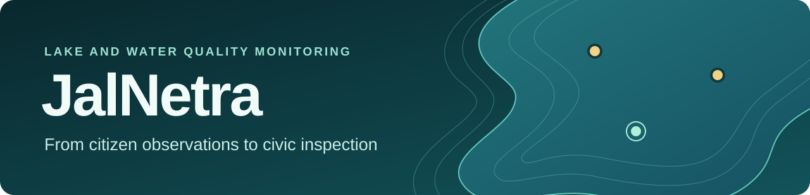
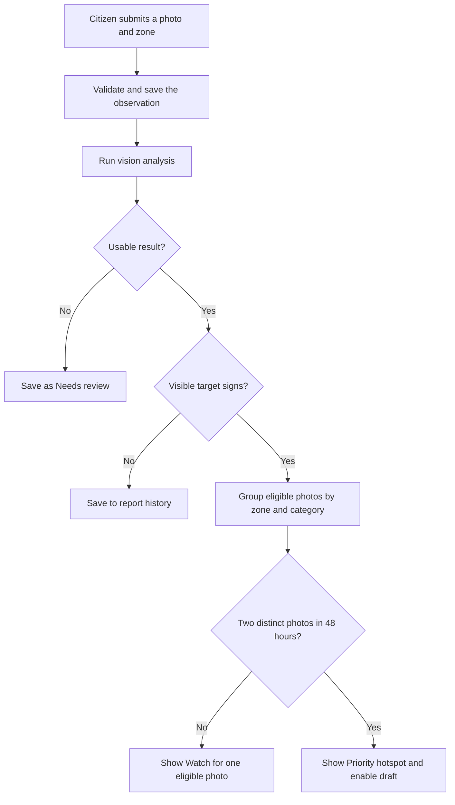
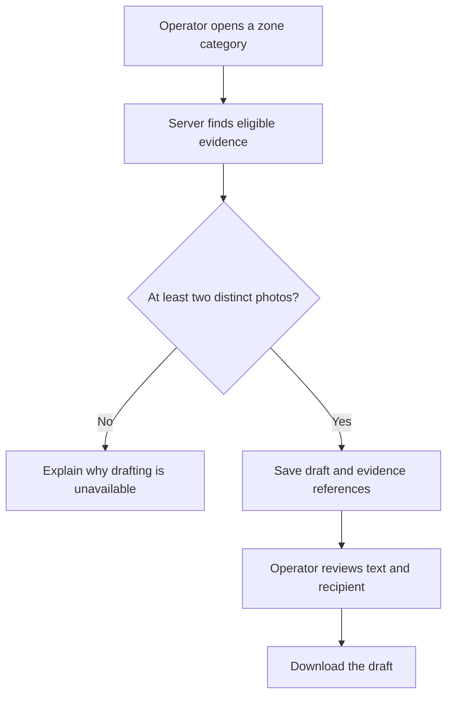
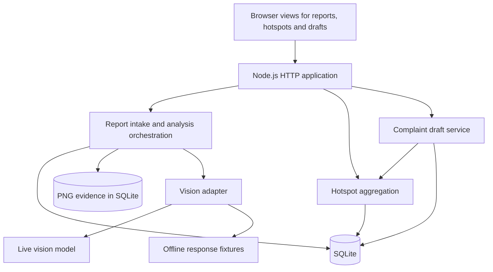
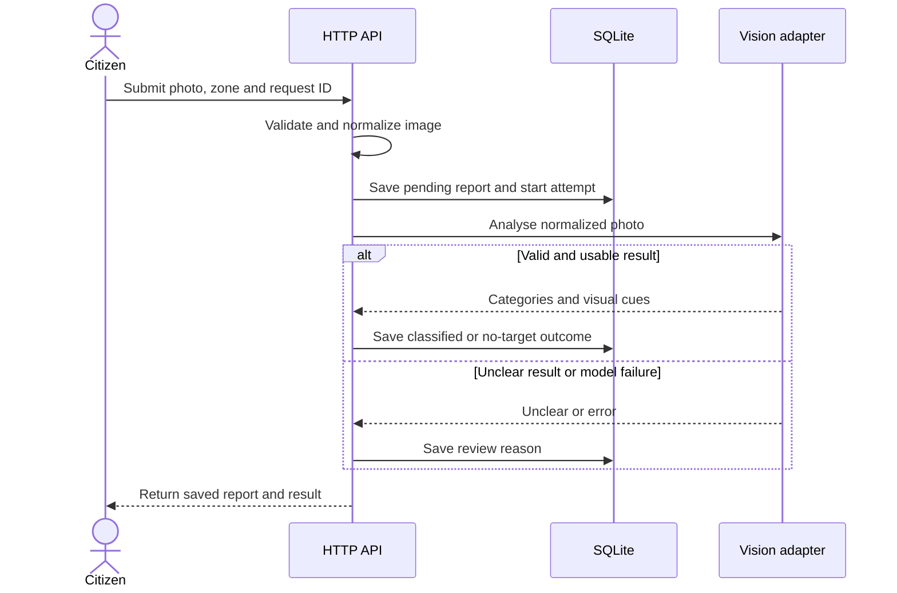
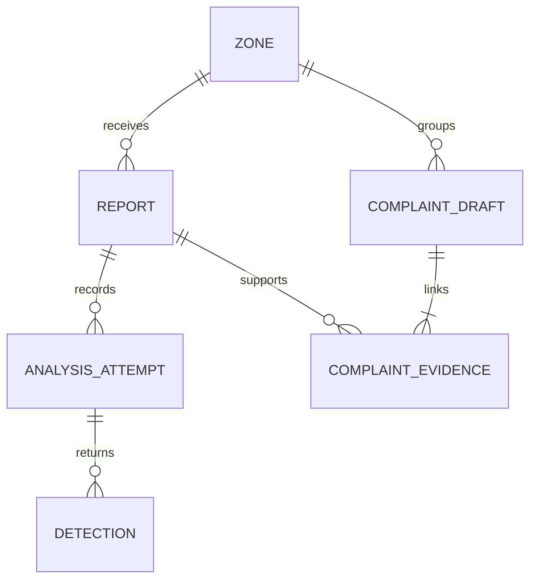

<p align="center">
  
</p>

# JalNetra

**Lake and water quality monitoring through citizen reports, visual evidence, and civic follow-up.**

A resident photographs a shoreline issue and selects a zone. JalNetra identifies visible signs of foam, algae-like growth, or dumping, groups related observations on a hotspot map, and prepares a civic complaint draft that lists the supporting report IDs.

**[Open JalNetra](https://jalnetra-wine.vercel.app/)** · [Try the demo](https://jalnetra-wine.vercel.app/?demo=1)

## Try the hosted demo

1. Click **Start rehearsal** to seed a foam observation at **North Inlet**. The zone starts at **Watch**.
2. Under **Offline demo images**, choose **Foam from a second view**, keep **North Inlet** selected, and click **Save observation**. The second distinct photo raises the zone to **Priority hotspot**.
3. Open the hotspot, then click **Open complaint draft** and **Download draft**. The exported draft includes both report IDs.
4. Select **Obscured view** and submit it to see how the app routes an unclear image to review.

The public demo uses labelled simulated vision results. Each browser gets an isolated session that survives a refresh and expires after seven days. **Restart rehearsal** replaces the observations in that session with the starting example. Complaint drafts are for review and download.

## Run and test locally

From the repository root, use **Node.js 24**.

```bash
node src/server.js
node --test
```

Open `http://127.0.0.1:3000`. The local server runs without installing packages and saves reports in `data/jalnetra.sqlite`. To rehearse without internet or an API key, run `node src/server.js --rehearsal` and follow the same demo steps. The local rehearsal uses an in-memory database.

### Enable live vision locally

Copy `.env.example` to `.env.local`, set `JALNETRA_MODE=live`, and supply `OPENAI_API_KEY` and `JALNETRA_VISION_MODEL` for an image-capable Responses API model that supports structured outputs.

```bash
node --env-file=.env.local src/server.js
```

During analysis the server sends the normalized photo and the vision prompt to the provider. Local live reports and demo reports use separate datasets.

### Deploy to Vercel

Use Node.js 24 and the repository's `vercel.json`. Connect a **private Vercel Blob store** to the project with `BLOB_READ_WRITE_TOKEN` available to the server function. The hosted function stores a private SQLite snapshot for each browser session.

The current production site was deployed directly from this repository's source. Automatic redeploys from GitHub require connecting the repository to the Vercel project. The automated test workflow checks code and does not publish the site.

### Field pilot backend

Use **Report to lake operator** for citizen submissions or **Operator sign in** to review evidence. Supabase stores shared photos, observations and concerns for authorized users across devices. Lake administrators manage operator access. Assigned operators can request live photo analysis, record review decisions, and link possible duplicates. The operator map groups recent reviewed evidence by shoreline sector and category. Priority groups can generate an editable complaint draft for download. The public rehearsal keeps its own data. Public account confirmation requires custom SMTP.

### Bengaluru lake maps and water readings

The **Bengaluru lake map** opens with a regional view from Devanahalli and Kempegowda International Airport to Electronic City. It includes 21 named reporting lakes across north, south, east, west, and central Bengaluru. Drag to pan or use the map buttons to zoom, reset, and expand. The expanded map supports scroll and pinch zoom. With the map focused, arrow keys pan and plus and minus zoom.

Choose a pin or use the lake list below the map. The map opens in its compact layout and focuses on the selected lake. Use **Expand map** to enlarge it. The lake profile and shoreline sectors appear beside the map. **Report to lake operator** opens shared sign-in with the selected lake and sector. On small screens they sit below it. Select an approximate north, east, south, or west shoreline sector on the map or in the form. Optional readings and notes are saved with the photo. Use **Back to lake search** to return to the regional view.

Open **Raise a concern** to record suspected wastewater discharge, waste dumping, sewage overflow, or another shoreline issue. Select a sector and describe what you observed. JalNetra gives the concern a reference number and a downloadable text copy for sharing. The hosted demo saves concerns in the submitting browser's session and does not send them to authorities.

**Suggest zone from GPS** works when the browser can obtain an accurate location near the selected lake. The app saves the selected sector, while GPS coordinates stay in the browser. Manual zone selection is available. The illustrative Demo Lake stays available offline and uses labelled sample images.

**Water readings** shows separately plotted pH and temperature measurements, a zone filter, and a chronological table for up to 100 observations from the last 30 days. Report and hotspot cards show submitted readings and notes. Entries distinguish citizen-reported values from rehearsal examples. The hosted **Try demo** workspace shows simulated observations. The signed-in reporting workspace saves shared observations in Supabase.

## What the project solves

Lake observations often arrive as isolated photos or messages. To follow up, a civic operator needs a location, an observation time, and a way to connect related reports. JalNetra keeps those details together and shows exactly which reports support an inspection request.

| Citizen | Civic operator |
|---|---|
| Uploads a photo, selects a shoreline zone, and can add a note, pH, or temperature. | Opens a zone, compares supporting photos and model cues, and prepares a complaint draft. |
| Sees what the model detected or why the image needs review. | Sees what changed the hotspot status and can export a draft with evidence IDs. |

A photo records visible signs. Assessing water quality or confirming a pollution source requires field verification and appropriate testing.

## Product workflow

### From photo to complaint



**Example** — The first eligible foam photo at North Inlet starts a **Watch**. A second distinct eligible photo of foam from the same zone within 48 hours raises a **Priority hotspot**. A repeated upload appears in history and adds zero to the count. The 48-hour window and two-photo threshold are prototype rules.

### Phase 1 · Report intake

The citizen selects **North Inlet**, **East Shore**, or **South Bank** on Demo Lake and submits a JPEG or PNG up to 5 MB. The app records observation and submission times separately, stores them in UTC, and displays them in IST. Optional pH, temperature, and notes stay with the observation. Readings are labelled **Citizen-reported** and do not affect hotspot scoring. Real pilot zones may include approximate coordinates.

The browser decodes and resizes the image. The server validates the pixels, encodes a PNG, and saves a **Pending** report. A retry with the same request ID and payload returns the existing report.

**Phase output** — A saved observation with a stable report ID, photo, zone, and timestamp.

### Phase 2 · Vision analysis

The vision adapter checks image quality and returns a short visual cue for each detected category. A usable image can show **foam**, **algae-like growth**, **dumping**, or no target signs. Unclear photos, invalid responses, and model failures go to **Needs review**. The saved observation stays available for a retry where applicable.

**Phase output** — A report outcome with visible cues, a no-signs result, or a review reason.

### Phase 3 · Hotspot mapping

On dashboard load and before drafting, the server groups eligible reports by data mode, lake, shoreline zone, and category. It uses observation times from the last 48 hours through the current time. Each normalized image fingerprint counts once per group. For duplicates, use the most recent eligible observation and break equal-time ties by report ID.

One eligible photo starts **Watch**. Two distinct eligible photos raise a **Priority hotspot**. A zone marker shows its highest-priority status. Opening the marker reveals the categories, thumbnails, observation times, and model cues. Older and unclear reports remain in history.

**Phase output** — An interactive zone map with explainable hotspot counts and supporting observations.

### Phase 4 · Civic complaint drafting

The operator opens a priority category and requests a draft. The server checks eligibility again and saves the draft with the exact evidence report IDs. The operator can edit the wording or recipient and download the result. The operator verifies which civic body should receive a real complaint.

**Phase output** — An editable complaint draft with a traceable evidence list.

### Classification outcomes

| Situation | Display | Effect |
|---|---|---|
| Valid, usable image with a target sign | Classified | Consider each returned category independently. |
| Usable image with zero target signs | No target signs detected | Save in history. |
| Unclear photo, time limit, provider failure, or malformed response | Needs review | Save the reason and allow retry where applicable. |
| One unique eligible photo in a group | Watch | Show the category in zone details. |
| At least two unique eligible photos in a group | Priority hotspot | Enable complaint generation for the category. |
| Same normalized image in a group | Duplicate evidence | Save in history and count once. |
| Observation beyond the 48-hour window | Outside active window | Preserve the history and recalculate current status. |

### Complaint decision flow



Each draft includes the lake and zone, approximate location if available, observed category, count, evidence IDs and timestamps, and a request for inspection. It can include citizen-reported readings and attachment names. Keep the draft factual. For example, use “Two photos show visible foam near North Inlet” and ask for inspection of the area.

Two different images may depict the same scene. Pixel fingerprints catch repeated normalized files and provide a practical first-pass count. Field observations and a verified agency routing process belong in a pilot.

## System architecture

### Component diagram



| Component | Responsibility |
|---|---|
| Browser | Render the form, bundled map, status labels, evidence panel, history, and draft editor. |
| HTTP API | Serve the frontend and API from the same origin. Validate requests, identify the active data mode, and return consistent errors. |
| Intake | Validate format, byte limit and image dimensions. Strip metadata, save only the normalized image, and fingerprint it for evidence deduplication. |
| Vision adapter | Give live and replay modes one result contract. Validate labels and cues against the allowlist and time out the live request at about 12 seconds. |
| Hotspot service | Compute eligible evidence and group status from the persisted facts. The dashboard and complaint service share the same calculation. |
| Draft service | Recheck eligibility and save the draft with evidence report IDs in one transaction. |
| Persistence | SQLite stores zones, report and analysis history, and complaint drafts. Normalized PNG photos are stored in SQLite and served by report ID. |

### Upload and analysis sequence



**Retry handling.** Uniquely constrain request IDs per data mode. Store the report and PNG bytes together in one transaction. An identical repeat submission returns its existing report. Use a per-report attempt record with an expiry for model calls. Claim a retry atomically for one caller. A late response from an expired attempt must never replace the outcome of a fresher attempt.

### Data relationships



A report points to its current analysis attempt. Earlier attempts remain auditable. A draft records its selected evidence at generation time. Use that snapshot for later export even if a supporting report has aged out of the live dashboard.

### Runtime and data boundaries

| Concern | Prototype decision |
|---|---|
| Presentation | The public demo runs on Vercel. Local rehearsal runs from one Node.js process with bundled map data and fixtures. |
| Hosted storage | A secure session cookie scopes each browser to a private Blob snapshot. Snapshots expire after seven days. |
| Credentials | The vision key is supplied through an environment variable and stays on the server. |
| Model inputs | Send normalized pixels only. Keep citizen notes, readings and locations local during analysis. |
| Replay | Display the source and use demo-only data. Unknown replay images should return a clear unsupported-fixture outcome. |
| Citizen data | The prototype is a controlled demo. A pilot requires access controls, a retention policy, and verified complaint routing. |

### Suggested module order

Implement intake and storage first. Put vision adapters behind one interface so UI development can use fixtures. Next, make the map and complaint service call the same hotspot calculation. Add the demo reset after the end-to-end path works.

## API and data contract

Zone listing, report intake, history, and photo retrieval are implemented. Retry, hotspot, and complaint routes are implemented. Rehearsal reset is available in local in-memory rehearsal and in each isolated hosted session. All routes are scoped to the active dataset. Configure the dataset mode on the server and include it in API results and the UI. Use ISO 8601 timestamps with offsets for inputs and UTC timestamps for stored and returned values.

| Method and path | Inputs | Success |
|---|---|---|
| `GET /api/status` | None | `200` with the active mode and available offline samples. |
| `GET /api/zones` | None | `200` with zone IDs, names, optional coordinates, and marker positions. |
| `POST /api/reports` | Multipart fields listed below | `201` for a newly saved report. `200` for a repeat request that returns its existing report. |
| `GET /api/reports` | Optional `zoneId` filter | `200` with recent reports and status. Use a bounded result set. |
| `GET /api/reports/:id` | Report ID | `200` with report fields, analysis status, and photo URL. |
| `GET /api/reports/:id/photo` | Report ID | `200` with the normalized image and correct content type. |
| `POST /api/reports/:id/retry` | Report ID | `200` with the updated result or `202` with an already-running attempt. |
| `GET /api/hotspots` | None | `200` with zones and their current per-category evidence. |
| `POST /api/complaints` | JSON `zoneId`, `category` | `201` for a new draft or `200` for an existing draft with the same evidence. |
| `GET /api/complaints/:id` | Draft ID | `200` with the saved draft and its evidence. |
| `PATCH /api/complaints/:id` | JSON `recipient`, `draftText` | `200` with saved edits and the original evidence. |
| `GET /api/complaints/:id/export` | Draft ID | `200` with a downloadable text file. |
| `POST /api/demo/reset` | JSON object in rehearsal mode | `200` after resetting the current rehearsal session and seeding one Watch observation. |

Use `400` for invalid fields, `404` for records absent from the active dataset, `409` for a draft whose evidence no longer qualifies or reuse of a request ID with different content, `413` for oversized files, and `415` for unsupported files. A vision failure after a successful save returns the saved report with `needs_review` and a reason. Use a predictable error shape such as `{"error":{"code":"INVALID_ZONE","message":"Choose a listed shoreline zone."}}`.

### Report submission fields

| Field | Rule |
|---|---|
| `photo` | Raw RGB bytes from the form. The browser decodes a JPEG or PNG up to 5 MB and downsizes it to a maximum of 1,200 pixels on either side. |\n| `photoWidth` and `photoHeight` | Pixel dimensions from 1 to 1,200. The server requires exactly three RGB bytes per pixel and writes its own metadata-free PNG. |
| `zoneId` | Existing zone ID. |
| `observedAt` | Required timestamp with an offset. Reject future times. |
| `requestId` | Stable, unique client-generated ID for the submission and its retries. |
| `note` | Optional text, up to 500 characters. |
| `ph` and `temperatureC` | Optional finite numbers. Save empty values as null and display supplied values as citizen-reported. |

### Vision adapter response

```json
{
  "imageQuality": "usable",
  "detections": [
    {
      "category": "foam",
      "cue": "White froth gathers along the shoreline."
    }
  ]
}
```

Use `usable` or `unclear` for quality. The categories are `foam`, `algae_like_growth`, and `dumping`. Require at most one entry per category with a nonempty visual cue. An empty list with usable quality produces `no_target_signs`. Store adapter provenance as `live_model`, `captured_replay`, or `simulated`. Invalid output or an unavailable adapter produces `needs_review`.

### Example hotspot payload

```json
{
  "dataMode": "demo",
  "zones": [
    {
      "zoneId": "north-inlet",
      "status": "priority_hotspot",
      "categories": [
        {
          "category": "foam",
          "status": "priority_hotspot",
          "evidenceCount": 2,
          "evidenceReportIds": ["JN-001", "JN-002"]
        }
      ]
    }
  ]
}
```

Render zone statuses as `none`, `watch`, or `priority_hotspot`. Report analysis has its own states `pending`, `classified`, `no_target_signs`, and `needs_review`. Labels such as “Duplicate evidence” and “Outside active window” are calculated when displaying a group or report.

### SQLite schema

Enable foreign keys on every SQLite connection. Phase 1 stores PNG bytes in `report_photo` and fingerprints the normalized pixels and dimensions. Insert a generated draft and its evidence rows in one transaction. The schema below can be applied directly to a new database.

<details>
<summary>View the complete SQLite schema</summary>

```sql
PRAGMA foreign_keys = ON;

CREATE TABLE zone (
    id TEXT PRIMARY KEY,
    lake_name TEXT NOT NULL,
    name TEXT NOT NULL,
    latitude REAL CHECK (latitude BETWEEN -90 AND 90),
    longitude REAL CHECK (longitude BETWEEN -180 AND 180),
    marker_x REAL NOT NULL CHECK (marker_x BETWEEN 0 AND 1),
    marker_y REAL NOT NULL CHECK (marker_y BETWEEN 0 AND 1),
    UNIQUE (lake_name, name),
    CHECK ((latitude IS NULL) = (longitude IS NULL))
);

CREATE TABLE report (
    id TEXT PRIMARY KEY,
    data_mode TEXT NOT NULL CHECK (data_mode IN ('demo', 'live')),
    request_id TEXT NOT NULL,
    request_fingerprint TEXT NOT NULL,
    zone_id TEXT NOT NULL REFERENCES zone (id),
    observed_at TEXT NOT NULL,
    submitted_at TEXT NOT NULL,
    image_path TEXT NOT NULL UNIQUE,
    image_fingerprint TEXT NOT NULL,
    note TEXT,
    ph REAL,
    temperature_c REAL,
    current_attempt INTEGER,
    UNIQUE (data_mode, request_id),
    UNIQUE (id, data_mode, zone_id),
    FOREIGN KEY (id, current_attempt) REFERENCES analysis_attempt (report_id, attempt)
);

CREATE TABLE analysis_attempt (
    report_id TEXT NOT NULL REFERENCES report (id),
    attempt INTEGER NOT NULL CHECK (attempt > 0),
    source TEXT NOT NULL CHECK (source IN ('live_model', 'captured_replay', 'simulated')),
    status TEXT NOT NULL CHECK (status IN ('pending', 'classified', 'no_target_signs', 'needs_review')),
    image_quality TEXT CHECK (image_quality IN ('usable', 'unclear')),
    started_at TEXT NOT NULL,
    expires_at TEXT NOT NULL,
    finished_at TEXT,
    review_reason TEXT,
    PRIMARY KEY (report_id, attempt)
);

CREATE TABLE detection (
    report_id TEXT NOT NULL,
    attempt INTEGER NOT NULL,
    category TEXT NOT NULL CHECK (category IN ('foam', 'algae_like_growth', 'dumping')),
    cue TEXT NOT NULL CHECK (length(trim(cue)) > 0),
    PRIMARY KEY (report_id, attempt, category),
    FOREIGN KEY (report_id, attempt) REFERENCES analysis_attempt (report_id, attempt)
);

CREATE TABLE complaint_draft (
    id TEXT PRIMARY KEY,
    data_mode TEXT NOT NULL CHECK (data_mode IN ('demo', 'live')),
    zone_id TEXT NOT NULL REFERENCES zone (id),
    category TEXT NOT NULL CHECK (category IN ('foam', 'algae_like_growth', 'dumping')),
    recipient TEXT,
    draft_text TEXT NOT NULL,
    created_at TEXT NOT NULL,
    UNIQUE (id, data_mode, zone_id, category)
);

CREATE TABLE complaint_evidence (
    draft_id TEXT NOT NULL,
    data_mode TEXT NOT NULL,
    zone_id TEXT NOT NULL,
    category TEXT NOT NULL,
    report_id TEXT NOT NULL,
    attempt INTEGER NOT NULL,
    PRIMARY KEY (draft_id, report_id),
    FOREIGN KEY (draft_id, data_mode, zone_id, category)
        REFERENCES complaint_draft (id, data_mode, zone_id, category),
    FOREIGN KEY (report_id, data_mode, zone_id)
        REFERENCES report (id, data_mode, zone_id),
    FOREIGN KEY (report_id, attempt, category)
        REFERENCES detection (report_id, attempt, category)
);

CREATE INDEX report_active_zone ON report (data_mode, zone_id, observed_at);
CREATE INDEX evidence_report ON complaint_evidence (report_id);

CREATE TABLE report_photo (
    report_id TEXT PRIMARY KEY REFERENCES report (id) ON DELETE CASCADE,
    png BLOB NOT NULL
);
```

</details>

## Interface guide

Use two primary views, **Report observation** and **Lake dashboard**. Open the evidence and draft panels from the dashboard. Give the project a lake-blue and teal palette, use warm amber for Watch and a clearly labelled priority status. Use text labels and icons so colour is optional for interpreting the map.

| Screen | What appears | Primary action |
|---|---|---|
| Report observation | Zone selector, observation time, upload button and preview. Optional readings and notes sit in a collapsed section. | Analyse photo |
| Report result | Photo, visual cue or review reason, zone, time, optional readings, source label. | View on map or retry |
| Lake dashboard | Bundled shoreline map, legend, three zone markers and a keyboard-accessible zone list. Show mode near the title. | Open a zone |
| Evidence panel | Category, status, number of unique photos in the active window, and chronological report cards. | Generate draft when eligible |
| Complaint editor | Recipient and body fields, linked report IDs, visible evidence summary, and export control. | Download draft |

### Status copy

| State | Example copy |
|---|---|
| Running | “Photo saved. Analysing visible signs…” |
| Usable, no labels | “No target signs detected in this photo.” |
| Unclear | “Needs review. Try a clearer view of the shoreline.” |
| Timed out | “Photo saved. Analysis took too long. Retry when you’re ready.” |
| Watch | “1 matching photo in the last 48 hours.” |
| Priority | “2 distinct photos show foam in North Inlet.” |
| Duplicate | “This photo already counts toward this category.” |
| Evidence expired | “The observation is in history and outside the current 48-hour window.” |

Use descriptive labels for upload and form inputs. Show actionable validation next to the field, preserve selected values during errors, and announce upload results with an accessible status region. On narrow screens, put the zone list immediately below the map and stack evidence cards vertically. Mark all replay fixtures and fictional reports clearly in the interface.

## Build and demo plan

### Eight-hour build by phase

Phase 0 prepares the build. Phases 1–4 deliver the product workflow above. Phase 5 verifies the full path and prepares the presentation.

| Phase | Elapsed time | Developer A | Developer B | Checkpoint |
|---|---|---|---|---|
| 0 · Setup and shared contract | 0:00–0:30 | Agree on storage, API shapes, and model response fields. | Agree on screen flow and shared test fixtures. | Both developers can work from the same contract. |
| 1 · Report intake | 0:30–2:00 | Set up SQLite, seed zones, and validate uploads. | Build the report form, image preview, and bundled map. | An uploaded photo gets a persistent report ID. |
| 2 · Vision analysis | 2:00–3:30 | Connect the live model and replay adapter. Validate output and handle timeouts. | Build the results panel using shared fixtures and connect it to the API. | A foam report displays its visual cue and an unclear report enters review. |
| 3 · Hotspot mapping | 3:30–4:30 | Implement the active window, grouping, and duplicate handling. | Connect the map and evidence panel to the hotspot API. | The first foam photo starts Watch. A distinct second photo raises priority. |
| 4 · Civic complaint drafting | 4:30–5:30 | Enforce eligibility and save drafts with their supporting evidence. | Build draft review, editing, and export. | The full upload-to-complaint path works. |
| 5 · Verification and presentation | 5:30–8:00 | Test failures, retries, duplicates, and restart persistence through 6:45. Then fix blockers and freeze the build. | Verify offline replay on the presentation laptop through 6:45. Then run two timed rehearsals and record a backup if time allows. | The full demo works on the presentation laptop with live analysis or labelled offline replay. |

If the build is running late, prioritise photo intake, the bundled zone map, evidence grouping and plain-text complaint export. Category filters, map tiles and manual review controls can follow the demo.

### Acceptance checklist

- [ ] A foam photo at North Inlet starts Watch and shows its model evidence.
- [ ] A second distinct foam image in North Inlet inside the active window makes the category a Priority hotspot.
- [ ] An identical normalized photo appears in history and adds zero to the count.
- [ ] Foam at South Bank and algae-like growth at North Inlet each form their own groups.
- [ ] Low-quality imagery, invalid model output and timeout save the report in Needs review.
- [ ] Retrying a submission preserves its report ID. Restarting the app preserves saved reports.
- [ ] An expired observation falls out of current counts and remains in history.
- [ ] Eligible drafting includes the correct source report IDs and timestamps. An ineligible draft request gets a clear rejection.
- [ ] Replay works with Wi-Fi off and cannot affect the live dataset.

### Three-minute demo

| Time | Action |
|---|---|
| 0:00–0:25 | Introduce the problem and open the map with a seeded Watch report at North Inlet. |
| 0:25–1:05 | Upload a distinct second foam photo. Point to the visible cue and the report’s time and location. |
| 1:05–1:40 | Open the priority marker and compare the two evidence cards. Explain the grouping rule. |
| 1:40–2:15 | Generate the complaint, show both report IDs and download the draft. |
| 2:15–2:45 | Show an unclear report in Needs review and show that the hotspot count stays the same. |
| 2:45–3:00 | Close with the pilot goal of validating the triage rule and civic routing. |

Developer B drives the screens. Developer A explains the model decision and grouping logic. Prepare two distinct photos with permission to display and one unclear photo. Use clearly labelled simulation data or captured model responses in offline mode, and reset only the demonstration dataset between runs.
