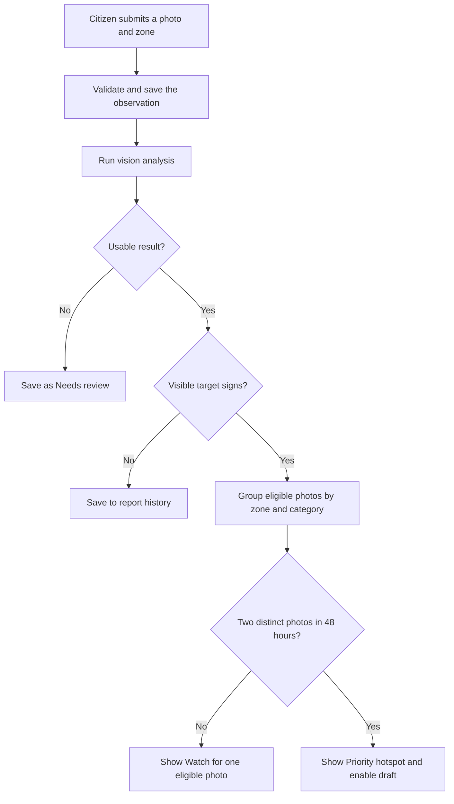
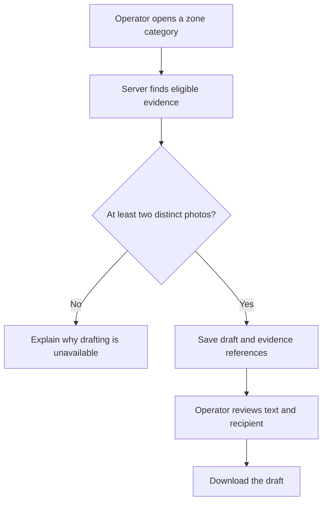

<p align="center">
  
</p>

# JalNetra

**Lake and water quality monitoring through citizen reports, visual evidence, and civic follow-up.**

A resident photographs a shoreline issue and selects a zone. JalNetra identifies visible signs of foam, algae-like growth, or dumping, groups related observations on a hotspot map, and prepares a civic complaint draft that lists the supporting report IDs.

**[Open JalNetra](https://jalnetra-wine.vercel.app/)** � [Try the demo](https://jalnetra-wine.vercel.app/?demo=1)

## Presenter walkthrough

1. On the homepage, click **Send demo concern** below the map. An example concern appears on Devanahalli Lake with a red **Demo alert** marker.
2. Click **Open demo in operator workspace** and sign in with an assigned operator account. The **Demo concern** card shows the same illustrated photo, location and sample assessment.
3. Click **Confirm demo concern**, then **Download demo complaint**. That download is for demonstration only.

## Try the hosted rehearsal

1. Click **Start rehearsal** to seed a foam observation at **North Inlet**. The zone starts at **Watch**.
2. Under **Offline demo images**, choose **Foam from a second view**, keep **North Inlet** selected, and click **Save observation**. The second distinct photo raises the zone to **Priority hotspot**.
3. Open the hotspot, then click **Open complaint draft** and **Download draft**. The exported draft includes both report IDs.
4. Select **Obscured view** and submit it to see how the app routes an unclear image to review.

The public demo uses labelled simulated vision results. Each browser gets an isolated session that survives a refresh and expires after seven days. **Restart rehearsal** replaces the observations in that session with the starting example. Complaint drafts are for review and download.

## Run and test locally

From the repository root, use **Node.js 24**.

```bash
node src/server.js
node --test
```

Open `http://127.0.0.1:3000`. The local server runs without installing packages and saves reports in `data/jalnetra.sqlite`. To rehearse without internet or an API key, run `node src/server.js --rehearsal` and follow the same demo steps. The local rehearsal uses an in-memory database.

### Enable live vision locally

Copy `.env.example` to `.env.local`, set `JALNETRA_MODE=live`, and supply `OPENAI_API_KEY` and `JALNETRA_VISION_MODEL` for an image-capable Responses API model that supports structured outputs.

```bash
node --env-file=.env.local src/server.js
```

During analysis the server sends the normalized photo and the vision prompt to the provider. Local live reports and demo reports use separate datasets.

### Deploy to Vercel

Use Node.js 24 and the repository's `vercel.json`. Connect a **private Vercel Blob store** to the project with `BLOB_READ_WRITE_TOKEN` available to the server function. The hosted function stores a private SQLite snapshot for each browser session.

The current production site was deployed directly from this repository's source. Automatic redeploys from GitHub require connecting the repository to the Vercel project. The automated test workflow checks code and does not publish the site.

### Field pilot backend

Use **Report to lake operator** for citizen submissions or **Operator sign in** to review evidence. Supabase stores shared photos, observations and concerns for authorized users across devices. Lake administrators manage operator access. Assigned operators can request live photo analysis, record review decisions, and link possible duplicates. The operator map groups recent reviewed evidence by shoreline sector and category. Priority groups can generate an editable complaint draft for download. The public rehearsal keeps its own data. Public account confirmation requires custom SMTP.

### Bengaluru lake maps and water readings

The **Bengaluru lake map** opens with a regional view from Devanahalli and Kempegowda International Airport to Electronic City. It includes 21 named reporting lakes across north, south, east, west, and central Bengaluru. Drag to pan or use the map buttons to zoom, reset, and expand. The expanded map supports scroll and pinch zoom. With the map focused, arrow keys pan and plus and minus zoom.

Choose a pin or use the lake list below the map. The map opens in its compact layout and focuses on the selected lake. Use **Expand map** to enlarge it. The lake profile and shoreline sectors appear beside the map. **Report to lake operator** opens shared sign-in with the selected lake and sector. On small screens they sit below it. Select an approximate north, east, south, or west shoreline sector on the map or in the form. Optional readings and notes are saved with the photo. Use **Back to lake search** to return to the regional view.

Open **Raise a concern** to record suspected wastewater discharge, waste dumping, sewage overflow, or another shoreline issue. Select a sector and describe what you observed. JalNetra gives the concern a reference number and a downloadable text copy for sharing. The hosted demo saves concerns in the submitting browser's session and does not send them to authorities.

**Suggest zone from GPS** works when the browser can obtain an accurate location near the selected lake. The app saves the selected sector, while GPS coordinates stay in the browser. Manual zone selection is available. The illustrative Demo Lake stays available offline and uses labelled sample images.

**Water readings** shows separately plotted pH and temperature measurements, a zone filter, and a chronological table for up to 100 observations from the last 30 days. Report and hotspot cards show submitted readings and notes. Entries distinguish citizen-reported values from rehearsal examples. The hosted **Try demo** workspace shows simulated observations. The signed-in reporting workspace saves shared observations in Supabase.

## What the project solves

Lake observations often arrive as isolated photos or messages. To follow up, a civic operator needs a location, an observation time, and a way to connect related reports. JalNetra keeps those details together and shows exactly which reports support an inspection request.

| Citizen | Civic operator |
|---|---|
| Uploads a photo, selects a shoreline zone, and can add a note, pH, or temperature. | Opens a zone, compares supporting photos and model cues, and prepares a complaint draft. |
| Sees what the model detected or why the image needs review. | Sees what changed the hotspot status and can export a draft with evidence IDs. |

A photo records visible signs. Assessing water quality or confirming a pollution source requires field verification and appropriate testing.

## Product workflow

### From photo to complaint



**Example** - The first eligible foam photo at North Inlet starts a **Watch**. A second distinct eligible photo of foam from the same zone within 48 hours raises a **Priority hotspot**. A repeated upload appears in history and adds zero to the count. The 48-hour window and two-photo threshold are prototype rules.

### Phase 1 � Report intake

The citizen selects **North Inlet**, **East Shore**, or **South Bank** on Demo Lake and submits a JPEG or PNG up to 5 MB. The app records observation and submission times separately, stores them in UTC, and displays them in IST. Optional pH, temperature, and notes stay with the observation. Readings are labelled **Citizen-reported** and do not affect hotspot scoring. Real pilot zones may include approximate coordinates.

The browser decodes and resizes the image. The server validates the pixels, encodes a PNG, and saves a **Pending** report. A retry with the same request ID and payload returns the existing report.

**Phase output** - A saved observation with a stable report ID, photo, zone, and timestamp.

### Phase 2 � Vision analysis

The vision adapter checks image quality and returns a short visual cue for each detected category. A usable image can show **foam**, **algae-like growth**, **dumping**, or no target signs. Unclear photos, invalid responses, and model failures go to **Needs review**. The saved observation stays available for a retry where applicable.

**Phase output** - A report outcome with visible cues, a no-signs result, or a review reason.

### Phase 3 � Hotspot mapping

On dashboard load and before drafting, the server groups eligible reports by data mode, lake, shoreline zone, and category. It uses observation times from the last 48 hours through the current time. Each normalized image fingerprint counts once per group. For duplicates, use the most recent eligible observation and break equal-time ties by report ID.

One eligible photo starts **Watch**. Two distinct eligible photos raise a **Priority hotspot**. A zone marker shows its highest-priority status. Opening the marker reveals the categories, thumbnails, observation times, and model cues. Older and unclear reports remain in history.

**Phase output** - An interactive zone map with explainable hotspot counts and supporting observations.

### Phase 4 � Civic complaint drafting

The operator opens a priority category and requests a draft. The server checks eligibility again and saves the draft with the exact evidence report IDs. The operator can edit the wording or recipient and download the result. The operator verifies which civic body should receive a real complaint.

**Phase output** - An editable complaint draft with a traceable evidence list.

### Classification outcomes

| Situation | Display | Effect |
|---|---|---|
| Valid, usable image with a target sign | Classified | Consider each returned category independently. |
| Usable image with zero target signs | No target signs detected | Save in history. |
| Unclear photo, time limit, provider failure, or malformed response | Needs review | Save the reason and allow retry where applicable. |
| One unique eligible photo in a group | Watch | Show the category in zone details. |
| At least two unique eligible photos in a group | Priority hotspot | Enable complaint generation for the category. |
| Same normalized image in a group | Duplicate evidence | Save in history and count once. |
| Observation beyond the 48-hour window | Outside active window | Preserve the history and recalculate current status. |

### Complaint decision flow



Each draft includes the lake and zone, approximate location if available, observed category, count, evidence IDs and timestamps, and a request for inspection. It can include citizen-reported readings and attachment names. Keep the draft factual. For example, use 