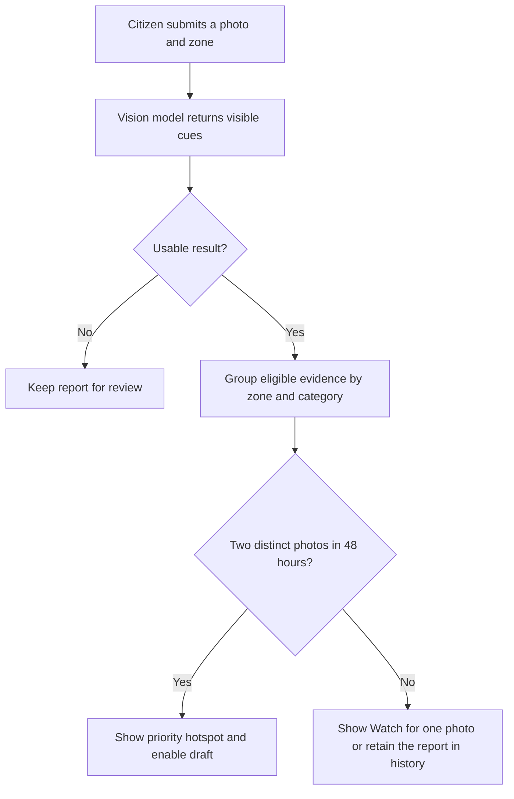

  

# JalNetra

**A lake monitoring prototype that turns citizen observations into evidence for civic inspection.**

A resident uploads a shoreline photo and selects a zone. A vision model describes visible signs of foam, algae-like growth, or dumping. JalNetra groups matching observations on a hotspot map and prepares a complaint draft linked to the supporting reports.

**Project status:** Hackathon design and build plan. This repository includes a starter SQLite schema. The application implementation is planned.

[User workflow](docs/WORKFLOW.md) · [System architecture](docs/ARCHITECTURE.md) · [API and data](docs/API.md) · [UI guide](docs/INTERFACE.md) · [Build and demo](docs/BUILD_AND_DEMO.md)

## What the judges will see

| Citizen | Civic operator |
|---|---|
| Upload a photo, pick a named shoreline zone, and optionally enter a note, pH, and temperature. | Open a highlighted zone, compare the photos and timestamps, and download an editable complaint draft. |
| Read the model’s visual cue or see that the photo needs review. | See why a report counts toward a hotspot and which observations support the draft. |

## From photo to complaint

The first foam photo at North Inlet starts a **Watch**. A second distinct photo of foam from the same zone within 48 hours makes it a **Priority hotspot**. A duplicate still appears in history and adds zero to the count. The two-photo threshold is a prototype triage rule. The model describes visible signs. Confirming water quality requires appropriate sampling and testing.

## Start here

| If you are… | Open… |
|---|---|
| Judging the project | [Demo sequence and expected results](docs/BUILD_AND_DEMO.md#three-minute-demo) |
| Building the backend | [Architecture](docs/ARCHITECTURE.md), [API contract](docs/API.md), and [SQLite schema](database/schema.sql) |
| Building the interface | [Screen layouts and interaction states](docs/INTERFACE.md) |
| Planning or testing the build | [Workflow rules](docs/WORKFLOW.md) and [acceptance checklist](docs/BUILD_AND_DEMO.md#acceptance-checklist) |

The one-day scope is **two developers, one lake, three shoreline zones, and a single laptop-hosted web app**. The planned stack is Node.js, Express, SQLite, and browser-native HTML, CSS, and JavaScript. The demo uses labelled sample data and an offline replay option. Complaint drafts are reviewed and exported by the operator.
