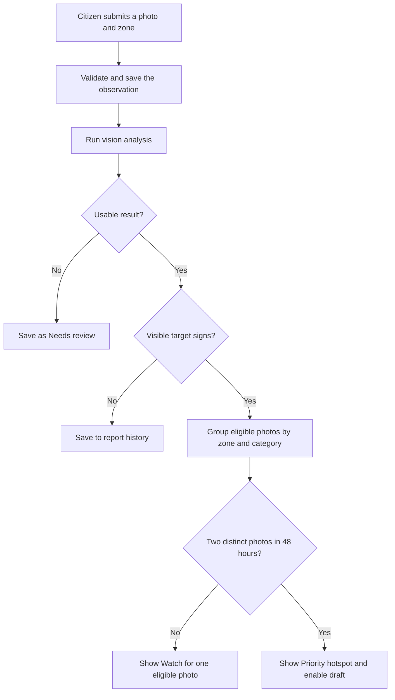
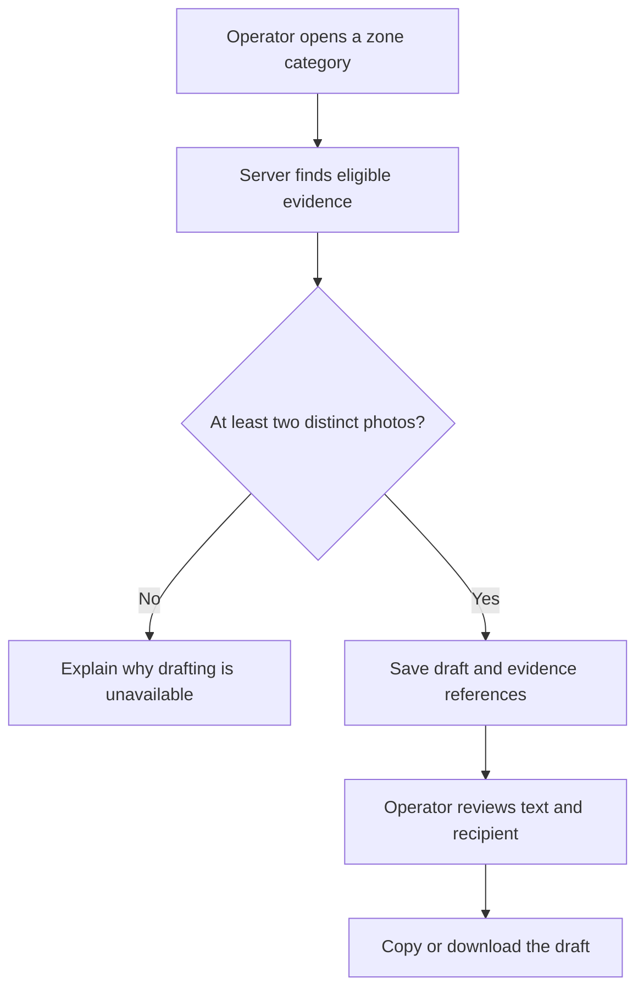
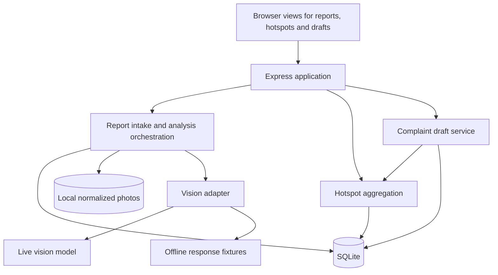
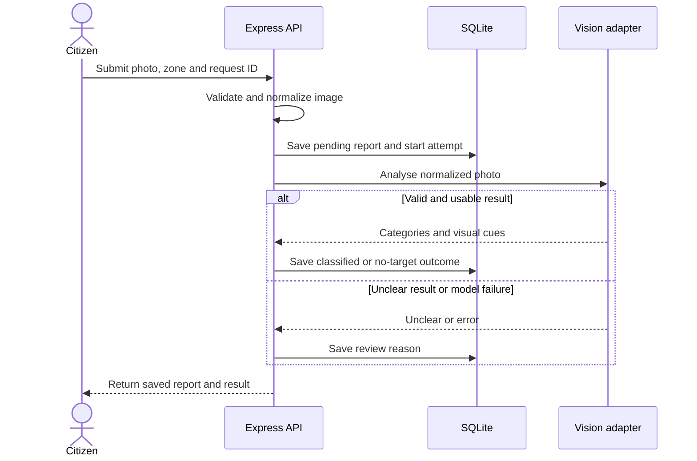
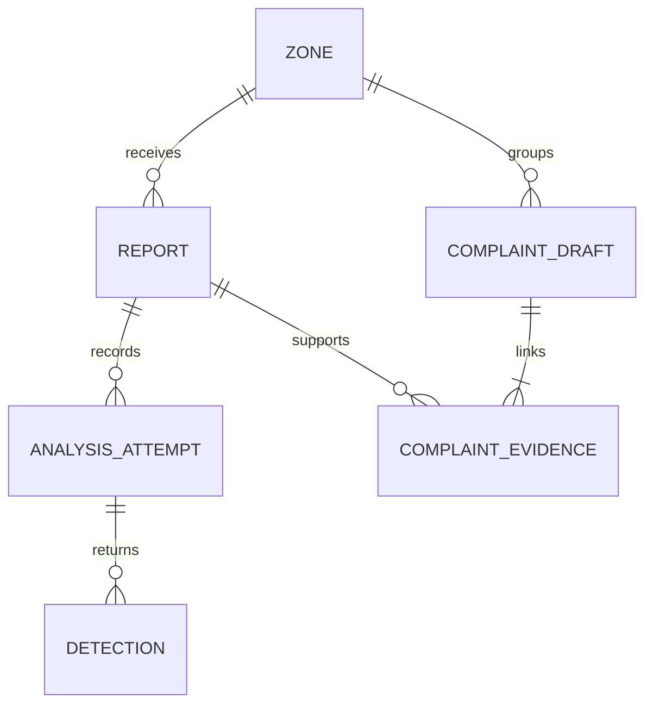

<p align="center">
  
</p>

# JalNetra

**Lake and water quality monitoring through citizen reports, visual evidence, and civic follow-up.**

A resident photographs a shoreline issue and selects a zone. JalNetra identifies visible signs of foam, algae-like growth, or dumping, groups related observations on a hotspot map, and prepares a civic complaint draft that lists the supporting report IDs.

**Current status** — Hackathon design and implementation plan with a starter SQLite schema. The runnable web app is planned.

| Scope | Plan |
|---|---|
| People and time | Two developers, eight working hours |
| Demo environment | One laptop, one demo lake, three preset shoreline zones |
| Planned stack | Node.js, Express, SQLite, and browser-native HTML, CSS, and JavaScript |
| Demo outcome | A second distinct photo raises a hotspot and enables an evidence-linked complaint draft |

## What the project solves

Lake observations often arrive as isolated photos or messages. To follow up, a civic operator needs a location, an observation time, and a way to connect related reports. JalNetra keeps those details together and shows exactly which reports support an inspection request.

| Citizen | Civic operator |
|---|---|
| Uploads a photo, selects a shoreline zone, and can add a note, pH, or temperature. | Opens a zone, compares supporting photos and model cues, and prepares a complaint draft. |
| Sees what the model detected or why the image needs review. | Sees what changed the hotspot status and can export a draft with evidence IDs. |

A photo records visible signs. Assessing water quality or confirming a pollution source requires field verification and appropriate testing.

## Product workflow

### From photo to complaint



**Example** — The first eligible foam photo at North Inlet starts a **Watch**. A second distinct eligible photo of foam from the same zone within 48 hours raises a **Priority hotspot**. A repeated upload appears in history and adds zero to the count. The 48-hour window and two-photo threshold are prototype rules.

### How an observation is processed

1. Select **North Inlet**, **East Shore**, or **South Bank** on Demo Lake. Zone coordinates are approximate if a real pilot map is configured. The fictional map may omit them.
2. Submit a JPEG or PNG up to 5 MB. Record observation time separately from submission time. Store UTC and show IST to the demo audience. Optional pH and temperature are marked **Citizen-reported** and excluded from hotspot rules.
3. Validate, decode, and re-encode the photo. Persist a report before calling the model. Repeated submission of the same request ID returns the existing report.
4. Ask the model for image quality and visible cues from the categories **foam**, **algae-like growth**, and **dumping**. A usable photo can return multiple categories or no target signs. Invalid responses and unclear photos enter **Needs review**.
5. Recompute active evidence on dashboard load and when drafting. For each data mode, lake, zone and category, count one accepted observation per normalized image fingerprint, using observation times from the previous 48 hours through the current time. Choose the most recent eligible observation as the representative for a duplicate fingerprint. Break equal-time ties by report ID to keep output stable.
6. Open the highest-priority marker for a zone and select a category. The detail panel lists its qualifying reports, times, thumbnails, and model cues. Older or unclear reports remain available in history.
7. Generate a draft when the category qualifies, then edit the recipient or wording and export. The operator verifies which civic body should receive a real complaint.

### Classification outcomes

| Situation | Display | Effect |
|---|---|---|
| Valid, usable image with a target sign | Classified | Consider each returned category independently. |
| Usable image with zero target signs | No target signs detected | Save in history. |
| Unclear photo, time limit, provider failure, or malformed response | Needs review | Save the reason and allow retry where applicable. |
| One unique eligible photo in a group | Watch | Show the category in zone details. |
| At least two unique eligible photos in a group | Priority hotspot | Enable complaint generation for the category. |
| Same normalized image in a group | Duplicate evidence | Save in history and count once. |
| Observation beyond the 48-hour window | Outside active window | Preserve the history and recalculate current status. |

### Complaint decision flow



Each draft includes the lake and zone, approximate location if available, observed category, count, evidence IDs and timestamps, and a request for inspection. It can include citizen-reported readings and attachment names. Keep the draft factual. For example, use “Two photos show visible foam near North Inlet” and ask for inspection of the area.

Two different images may depict the same scene. Pixel fingerprints catch repeated normalized files and provide a practical first-pass count. Field observations and a verified agency routing process belong in a pilot.

## System architecture

### Component diagram



| Component | Responsibility |
|---|---|
| Browser | Render the form, bundled map, status labels, evidence panel, history, and draft editor. |
| Express API | Serve the frontend and API from the same origin. Validate requests, identify the active data mode, and return consistent errors. |
| Intake | Validate format, byte limit and image dimensions. Strip metadata, save only the normalized image, and fingerprint it for evidence deduplication. |
| Vision adapter | Give live and replay modes one result contract. Validate labels and cues against the allowlist and time out the live request at about 12 seconds. |
| Hotspot service | Compute eligible evidence and group status from the persisted facts. The dashboard and complaint service share the same calculation. |
| Draft service | Recheck eligibility and save the draft with evidence report IDs in one transaction. |
| Persistence | SQLite stores zones, report and analysis history, and complaint drafts. Normalized photos are kept in a local folder and served by report ID. |

### Upload and analysis sequence



**Retry handling.** Uniquely constrain request IDs per data mode. Write normalized files under generated names, clean up temporary files on failed intake, and return an existing report for a repeat submission. Use a per-report attempt record with an expiry for model calls. Claim a retry atomically for one caller. A late response from an expired attempt must never replace the outcome of a fresher attempt.

### Data relationships



A report points to its current analysis attempt. Earlier attempts remain auditable. A draft records its selected evidence at generation time. Use that snapshot for later export even if a supporting report has aged out of the live dashboard.

### Runtime and data boundaries

| Concern | Prototype decision |
|---|---|
| Presentation | One local process on the presentation laptop. The map and fixtures ship with the build. |
| Credentials | The vision key is supplied through an environment variable and stays on the server. |
| Model inputs | Send normalized pixels only. Keep citizen notes, readings and locations local during analysis. |
| Replay | Display the source and use demo-only data. Unknown replay images should return a clear unsupported-fixture outcome. |
| Citizen data | The prototype is a controlled demo. A pilot requires access controls, a retention policy, and verified complaint routing. |

### Suggested module order

Implement intake and storage first. Put vision adapters behind one interface so UI development can use fixtures. Next, make the map and complaint service call the same hotspot calculation. Add the demo reset after the end-to-end path works.

## API and data contract

This is the contract for the planned local prototype. All routes are scoped to the active dataset. Configure the dataset mode on the server and include it in API results and the UI. Use ISO 8601 timestamps with offsets for inputs and UTC timestamps for stored and returned values.

| Method and path | Inputs | Success |
|---|---|---|
| `GET /api/zones` | None | `200` with zone IDs, names, optional coordinates, and marker positions. |
| `POST /api/reports` | Multipart fields listed below | `201` for a newly saved report. `200` for a repeat request that returns its existing report. |
| `GET /api/reports` | Optional `zoneId` filter | `200` with recent reports and status. Use a bounded result set. |
| `GET /api/reports/:id` | Report ID | `200` with fields, model result, and photo URL. |
| `GET /api/reports/:id/photo` | Report ID | `200` with the normalized image and correct content type. |
| `POST /api/reports/:id/retry` | Report ID | `200` with the updated result or `202` with an already-running attempt. |
| `GET /api/hotspots` | None | `200` with zones and their current per-category evidence. |
| `POST /api/complaints` | JSON `zoneId`, `category` | `201` with draft ID, recipient placeholder, generated text, and evidence IDs. |

Use `400` for invalid fields, `404` for records absent from the active dataset, `409` for a draft whose evidence no longer qualifies or reuse of a request ID with different content, `413` for oversized files, and `415` for unsupported files. A vision failure after a successful save returns the saved report with `needs_review` and a reason. Use a predictable error shape such as `{"error":{"code":"INVALID_ZONE","message":"Choose a listed shoreline zone."}}`.

### Report submission fields

| Field | Rule |
|---|---|
| `photo` | One JPEG or PNG, at most 5 MB. Decode it on the server before storing. |
| `zoneId` | Existing zone ID. |
| `observedAt` | Required timestamp with an offset. Reject future times. |
| `requestId` | Stable, unique client-generated ID for the submission and its retries. |
| `note` | Optional text, up to 500 characters. |
| `ph` and `temperatureC` | Optional finite numbers. Save empty values as null and display supplied values as citizen-reported. |

### Vision adapter response

```json
{
  "imageQuality": "usable",
  "detections": [
    {
      "category": "foam",
      "cue": "White froth gathers along the shoreline."
    }
  ]
}
```

Use `usable` or `unclear` for quality. The categories are `foam`, `algae_like_growth`, and `dumping`. Require at most one entry per category with a nonempty visual cue. An empty list with usable quality produces `no_target_signs`. Store adapter provenance as `live_model`, `captured_replay`, or `simulated`. Invalid output or an unavailable adapter produces `needs_review`.

### Example hotspot payload

```json
{
  "dataMode": "demo",
  "zones": [
    {
      "zoneId": "north-inlet",
      "status": "priority_hotspot",
      "categories": [
        {
          "category": "foam",
          "status": "priority_hotspot",
          "evidenceCount": 2,
          "evidenceReportIds": ["JN-001", "JN-002"]
        }
      ]
    }
  ]
}
```

Render zone statuses as `none`, `watch`, or `priority_hotspot`. Report analysis has its own states `pending`, `classified`, `no_target_signs`, and `needs_review`. Labels such as “Duplicate evidence” and “Outside active window” are calculated when displaying a group or report.

### SQLite schema

Enable foreign keys on every SQLite connection. Insert a generated draft and its evidence rows in one transaction. The schema below can be applied directly to a new database.

<details>
<summary>View the complete SQLite schema</summary>

```sql
PRAGMA foreign_keys = ON;

CREATE TABLE zone (
    id TEXT PRIMARY KEY,
    lake_name TEXT NOT NULL,
    name TEXT NOT NULL,
    latitude REAL CHECK (latitude BETWEEN -90 AND 90),
    longitude REAL CHECK (longitude BETWEEN -180 AND 180),
    marker_x REAL NOT NULL CHECK (marker_x BETWEEN 0 AND 1),
    marker_y REAL NOT NULL CHECK (marker_y BETWEEN 0 AND 1),
    UNIQUE (lake_name, name),
    CHECK ((latitude IS NULL) = (longitude IS NULL))
);

CREATE TABLE report (
    id TEXT PRIMARY KEY,
    data_mode TEXT NOT NULL CHECK (data_mode IN ('demo', 'live')),
    request_id TEXT NOT NULL,
    request_fingerprint TEXT NOT NULL,
    zone_id TEXT NOT NULL REFERENCES zone (id),
    observed_at TEXT NOT NULL,
    submitted_at TEXT NOT NULL,
    image_path TEXT NOT NULL UNIQUE,
    image_fingerprint TEXT NOT NULL,
    note TEXT,
    ph REAL,
    temperature_c REAL,
    current_attempt INTEGER,
    UNIQUE (data_mode, request_id),
    UNIQUE (id, data_mode, zone_id),
    FOREIGN KEY (id, current_attempt) REFERENCES analysis_attempt (report_id, attempt)
);

CREATE TABLE analysis_attempt (
    report_id TEXT NOT NULL REFERENCES report (id),
    attempt INTEGER NOT NULL CHECK (attempt > 0),
    source TEXT NOT NULL CHECK (source IN ('live_model', 'captured_replay', 'simulated')),
    status TEXT NOT NULL CHECK (status IN ('pending', 'classified', 'no_target_signs', 'needs_review')),
    image_quality TEXT CHECK (image_quality IN ('usable', 'unclear')),
    started_at TEXT NOT NULL,
    expires_at TEXT NOT NULL,
    finished_at TEXT,
    review_reason TEXT,
    PRIMARY KEY (report_id, attempt)
);

CREATE TABLE detection (
    report_id TEXT NOT NULL,
    attempt INTEGER NOT NULL,
    category TEXT NOT NULL CHECK (category IN ('foam', 'algae_like_growth', 'dumping')),
    cue TEXT NOT NULL CHECK (length(trim(cue)) > 0),
    PRIMARY KEY (report_id, attempt, category),
    FOREIGN KEY (report_id, attempt) REFERENCES analysis_attempt (report_id, attempt)
);

CREATE TABLE complaint_draft (
    id TEXT PRIMARY KEY,
    data_mode TEXT NOT NULL CHECK (data_mode IN ('demo', 'live')),
    zone_id TEXT NOT NULL REFERENCES zone (id),
    category TEXT NOT NULL CHECK (category IN ('foam', 'algae_like_growth', 'dumping')),
    recipient TEXT,
    draft_text TEXT NOT NULL,
    created_at TEXT NOT NULL,
    UNIQUE (id, data_mode, zone_id, category)
);

CREATE TABLE complaint_evidence (
    draft_id TEXT NOT NULL,
    data_mode TEXT NOT NULL,
    zone_id TEXT NOT NULL,
    category TEXT NOT NULL,
    report_id TEXT NOT NULL,
    attempt INTEGER NOT NULL,
    PRIMARY KEY (draft_id, report_id),
    FOREIGN KEY (draft_id, data_mode, zone_id, category)
        REFERENCES complaint_draft (id, data_mode, zone_id, category),
    FOREIGN KEY (report_id, data_mode, zone_id)
        REFERENCES report (id, data_mode, zone_id),
    FOREIGN KEY (report_id, attempt, category)
        REFERENCES detection (report_id, attempt, category)
);

CREATE INDEX report_active_zone ON report (data_mode, zone_id, observed_at);
CREATE INDEX evidence_report ON complaint_evidence (report_id);
```

</details>

## Interface guide

Use two primary views, **Report observation** and **Lake dashboard**. Open the evidence and draft panels from the dashboard. Give the project a lake-blue and teal palette, use warm amber for Watch and a clearly labelled priority status. Use text labels and icons so colour is optional for interpreting the map.

| Screen | What appears | Primary action |
|---|---|---|
| Report observation | Zone selector, observation time, upload button and preview. Optional readings and notes sit in a collapsed section. | Analyse photo |
| Report result | Photo, visual cue or review reason, zone, time, optional readings, source label. | View on map or retry |
| Lake dashboard | Bundled shoreline map, legend, three zone markers and a keyboard-accessible zone list. Show mode near the title. | Open a zone |
| Evidence panel | Category, status, number of unique photos in the active window, and chronological report cards. | Generate draft when eligible |
| Complaint editor | Recipient and body fields, linked report IDs, visible evidence summary, and export control. | Download draft |

### Status copy

| State | Example copy |
|---|---|
| Running | “Photo saved. Analysing visible signs…” |
| Usable, no labels | “No target signs detected in this photo.” |
| Unclear | “Needs review. Try a clearer view of the shoreline.” |
| Timed out | “Photo saved. Analysis took too long. Retry when you’re ready.” |
| Watch | “1 matching photo in the last 48 hours.” |
| Priority | “2 distinct photos show foam in North Inlet.” |
| Duplicate | “This photo already counts toward this category.” |
| Evidence expired | “The observation is in history and outside the current 48-hour window.” |

Use descriptive labels for upload and form inputs. Show actionable validation next to the field, preserve selected values during errors, and announce upload results with an accessible status region. On narrow screens, put the zone list immediately below the map and stack evidence cards vertically. Mark all replay fixtures and fictional reports clearly in the interface.

## Build and demo plan

### Eight-hour build

| Elapsed time | Developer A | Developer B | Exit check |
|---|---|---|---|
| 0:00–0:30 | Agree on storage and API shapes. | Agree on screen flow and sample responses. | Both developers work from the same contract. |
| 0:30–2:00 | Set up SQLite, seed zones and build upload validation. | Build report form, preview and bundled zone map. | A submitted photo receives a persistent report ID. |
| 2:00–3:30 | Connect the live model and replay adapter. Add limits, timeout and validation. | Build results and zone detail panels from fixtures. | The first foam photo shows Watch. |
| 3:30–4:30 | Build evidence times, grouping and deduplication. | Connect the map and evidence panel to the API. | A second distinct foam photo raises priority. |
| 4:30–5:30 | Implement complaint eligibility and draft storage. | Wire draft review, edit and export. | The core path works end to end. |
| 5:30–6:45 | Test errors, retries, duplicates and persistence. | Verify on the presentation device and rehearse offline replay. | Tests cover live and replay scenarios. |
| 6:45–8:00 | Fix blockers and freeze the build. | Run the script twice and record a backup if there is time. | The laptop can run the complete demo. |

If the build is running late, prioritise photo intake, the bundled zone map, evidence grouping and plain-text complaint export. Category filters, map tiles and manual review controls can follow the demo.

### Acceptance checklist

- [ ] A foam photo at North Inlet starts Watch and shows its model evidence.
- [ ] A second distinct foam image in North Inlet inside the active window makes the category a Priority hotspot.
- [ ] An identical normalized photo appears in history and adds zero to the count.
- [ ] Foam at South Bank and algae-like growth at North Inlet each form their own groups.
- [ ] Low-quality imagery, invalid model output and timeout save the report in Needs review.
- [ ] Retrying a submission preserves its report ID. Restarting the app preserves saved reports.
- [ ] An expired observation falls out of current counts and remains in history.
- [ ] Eligible drafting includes the correct source report IDs and timestamps. An ineligible draft request gets a clear rejection.
- [ ] Replay works with Wi-Fi off and cannot affect the live dataset.

### Three-minute demo

| Time | Action |
|---|---|
| 0:00–0:25 | Introduce the problem and open the map with a seeded Watch report at North Inlet. |
| 0:25–1:05 | Upload a distinct second foam photo. Point to the visible cue and the report’s time and location. |
| 1:05–1:40 | Open the priority marker and compare the two evidence cards. Explain the grouping rule. |
| 1:40–2:15 | Generate the complaint, show both report IDs and download the draft. |
| 2:15–2:45 | Show an unclear report in Needs review and show that the hotspot count stays the same. |
| 2:45–3:00 | Close with the pilot goal of validating the triage rule and civic routing. |

Developer B drives the screens. Developer A explains the model decision and grouping logic. Prepare two distinct photos with permission to display and one unclear photo. Use clearly labelled simulation data or captured model responses in offline mode, and reset only the demonstration dataset between runs.
